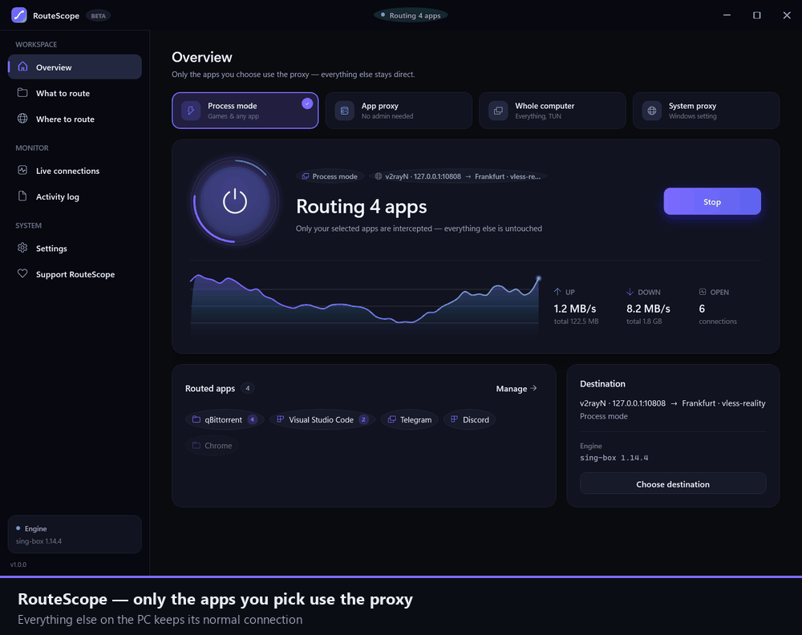

# RouteScope

**Route only the apps you choose through your proxy — not your whole PC.**

Pick a folder, an application, or a process name. Only those use the proxy. Everything else
keeps its normal connection, untouched — including programs that have no proxy setting at all.

Windows · .NET 10 + WPF · GPL-3.0 · no telemetry, no account



**[Step-by-step guide →](docs/GUIDE.md)**

---

## Why

| Approach | What it does | The catch |
| --- | --- | --- |
| System proxy | Points Windows at `127.0.0.1:port` | Only apps that respect the Windows proxy |
| TUN / whole-PC | Captures everything | Your bank, your LAN and your game's ping too |

RouteScope's default is neither: **you pick what gets proxied.** That makes it work for
programs that were never designed to speak to a proxy — launchers, game clients, native apps.

### Games and voice chat

This is where per-app routing earns its keep. A game launcher usually needs the proxy for its
store, login and updates, while the game itself wants the lowest ping straight out. With
RouteScope you can proxy the launcher and Discord, and leave the game on your normal connection
— or the reverse, proxying only the game while the rest of the PC stays direct.

Nothing else changes: your browser, your bank, your LAN and your other apps never enter the
tunnel, and your ping in an unproxied game is exactly what it was before.


---

## Capture modes

| Mode | Covers | Admin |
| --- | --- | --- |
| **Process mode** (default) | Any app or folder, even with no proxy support | Yes |
| **App proxy** | Chromium, Firefox, Java, and anything reading `HTTP_PROXY` | No |
| **Whole computer (TUN)** | Everything on the machine | Yes |
| **System proxy** | Apps that follow WinINet — usually just browsers | No |

Process mode asks the network filter driver for every outgoing connection together with the
process that made it. Matched processes are redirected to a local relay; unmatched ones are
left completely alone. No adapter, no firewall rules, no change to any other program.

---

## Quick start

1. Run `RouteScope.exe`. The wizard asks how to capture traffic — keep **Process mode** unless
   you would rather not run as administrator.
2. Add a folder or an app on **What to route**.
3. On **Where to route**, pick where traffic goes: a local proxy that is already running,
   a server you pasted, a WireGuard/OpenVPN config, or direct.
4. Press **Start routing**.
5. Launch your app and watch for the green **proxied** badge.

---

## What it supports

**Servers**
- Share links: `vless`, `vmess`, `trojan`, `ss`, `hysteria2`, `tuic`, `socks`, `http`, `anytls`
- Subscriptions, refreshable directly or *through the proxy*
- **WireGuard** — drop a `.conf`, or press *Add WireGuard*
- **OpenVPN** — drop an `.ovpn`; credentials are asked for when the file needs them
- Chain to a local proxy that is already running (v2rayN, Clash, Hiddify, Psiphon…)
- **Psiphon** as a managed hop, dialled through the hop above it so it works where its
  servers are blocked
- Two kinds of ping: a plain TCP check, or a *real* tunnel to the internet through that hop

**Routing**
- Folder, application or process-name targets, with child-process expansion for launchers
- Per-target switches and live connection counts
- LAN bypass, so printers, NAS and local multiplayer stay direct

**Chaining**
- Stack hops in any order; traffic exits from the last one
- Each hop is a genuine nested tunnel (`detour`), not a rewrite

**Engines**
- **sing-box** and **Xray-core**, chosen automatically per route or pinned in Settings
- Downloaded, versioned side by side and swapped in — a failed update never breaks a working install
- Mirror fallback and a *Download through the proxy* switch for blocked networks
- **Locate…** to register a copy you already have

**Monitoring**
- Live graph, session totals, connection table, filterable activity log

---

## Where things live

Everything stays in the app's own folder, next to the executable. Copy the folder anywhere,
including a USB stick, and your settings, engines and logs come with it.

```
RouteScope\
  RouteScope.exe
  data\routescope.json          your profile (human readable)
  engines\singbox\1.14.4\       versioned, side-by-side engines
  logs\routescope.log           app + engine log
  cache\                        downloads in flight
```

If the folder is read-only (e.g. `Program Files`), RouteScope falls back to
`%LOCALAPPDATA%\RouteScope`. Set `ROUTESCOPE_HOME` to force a location.

---

## Downloads

Two builds are published for each release:

| File | Contents |
| --- | --- |
| `RouteScope-win-x64.zip` | The app only. Engines are downloaded on first run. |
| `RouteScope-win-x64-bundled.zip` | The app plus sing-box, Xray-core, Psiphon and OpenVPN, ready to run offline. |

Both are portable — no installer, no registry entries beyond the optional "Start with Windows".

---

## Building from source

Requires Windows 10/11 and the .NET 10 SDK.

```powershell
dotnet build RouteScope.slnx
dotnet run --project src\RouteScope.App
.\tools\publish.ps1 -Zip          # portable folder + zip in dist\
```

There is a verification suite covering config generation, target matching and live routing:

```powershell
dotnet run --project tests\RouteScope.Verify          # offline checks
dotnet run --project tests\RouteScope.Verify -- e2e   # real engine, real traffic
```

---

## Limits

- **Process mode needs administrator** to load the filter driver, and the driver must be
  installed — RouteScope ships it and installs it on first use.
- **App proxy needs the app to cooperate.** For a native game, use process mode.
- **Whole-computer mode captures everything**, including services you did not think about.
- **Xray has no Clash API**, so the live connection list and traffic totals are sing-box only.
  RouteScope says so in the log when Xray is running.
- **Windows only.** The capture mechanisms depend on TUN, the filter driver, WinINet and
  Windows process APIs.

---

## Licence

GPL-3.0. See [NOTICE.md](NOTICE.md) for third-party attribution.

---

## Support

RouteScope is free, open source, and has no paid tier. If it earns it:

- **BEP20 (Binance Smart Chain)** — USDT or any token
  `0x5c2031e823f6c1774a1F842209bbE3b679cf3feC`
- **TRC20 (Tron)** — USDT or any token
  `TVtGyKkfm6RDEtW1yFau3EkNk9XXVdTJob`

Also worth just as much: starring the repository, reporting what breaks, and telling someone
who needs it. The same addresses are in the app under **Support RouteScope**.
