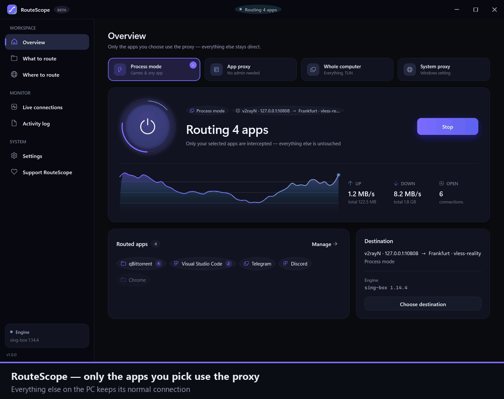
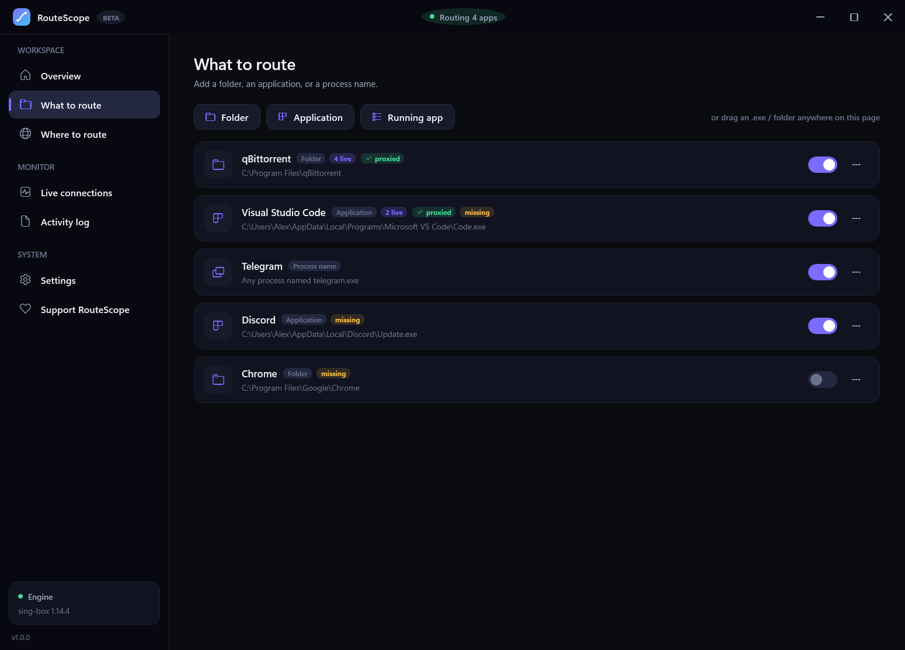
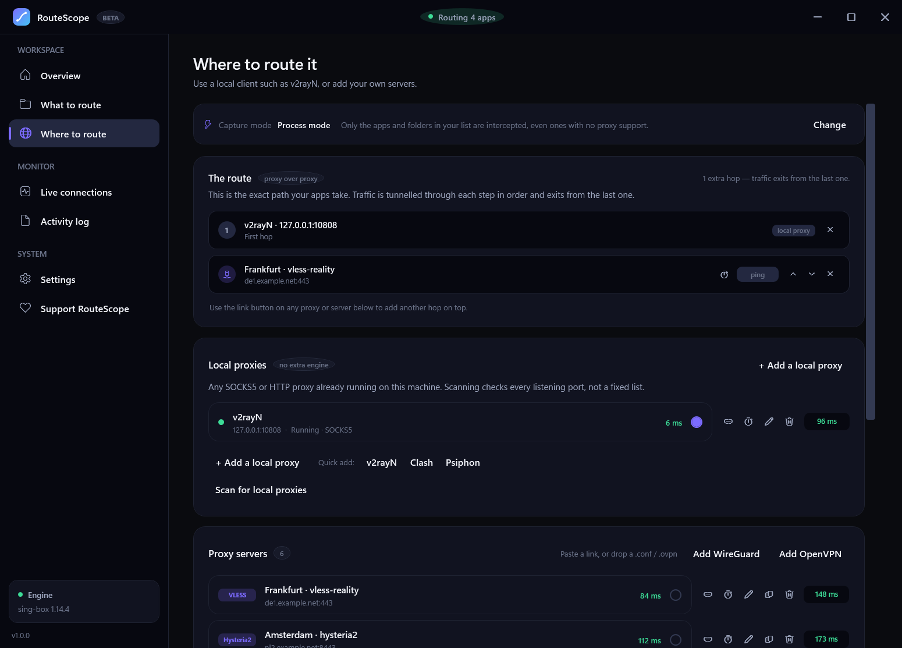
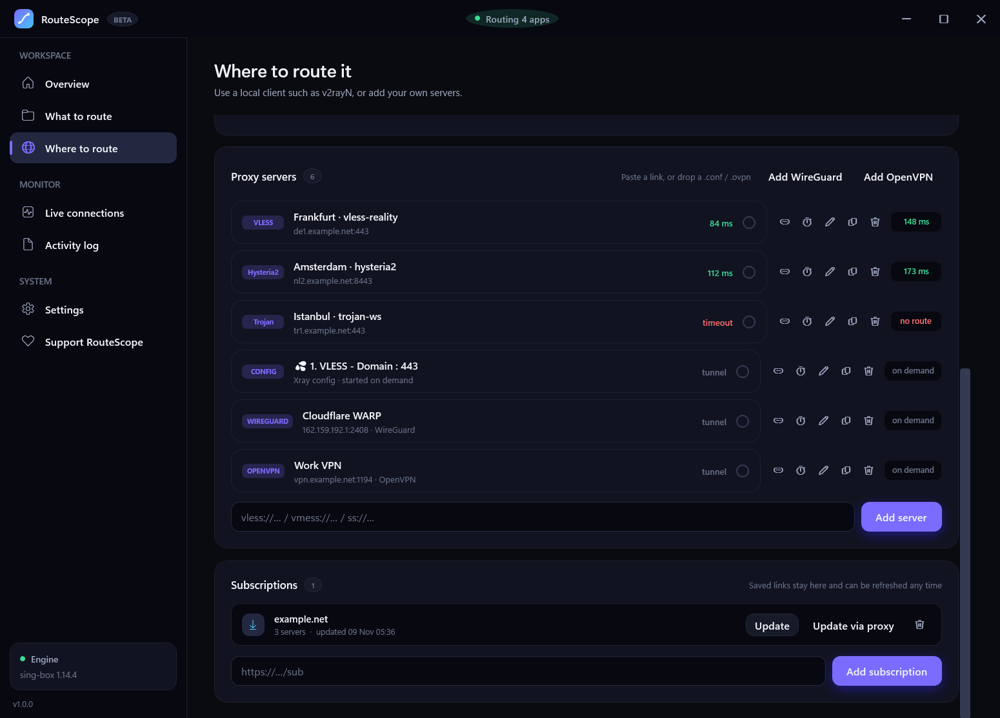
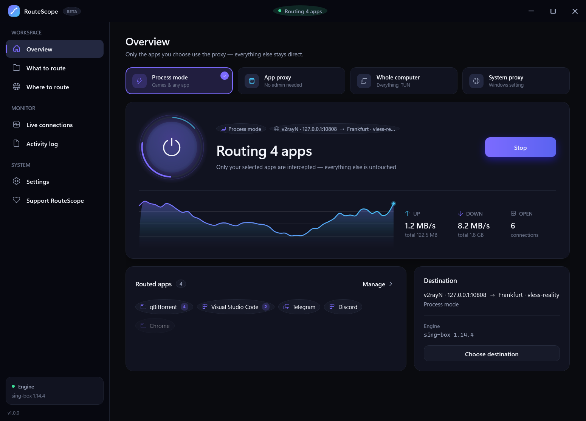
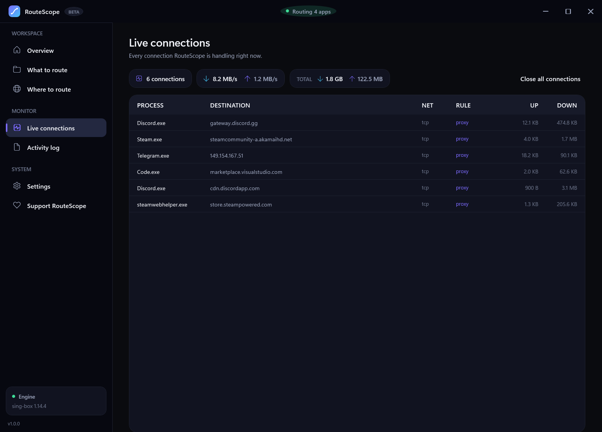
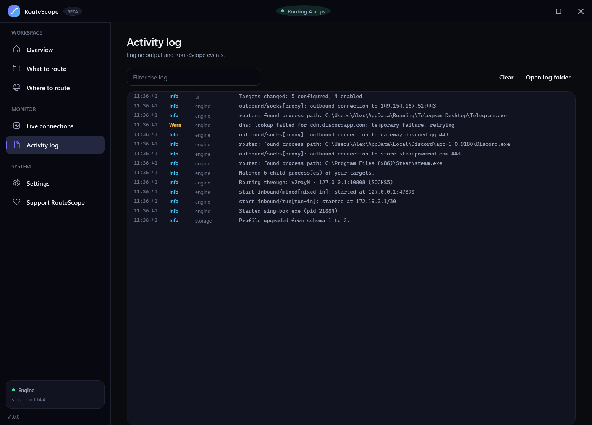
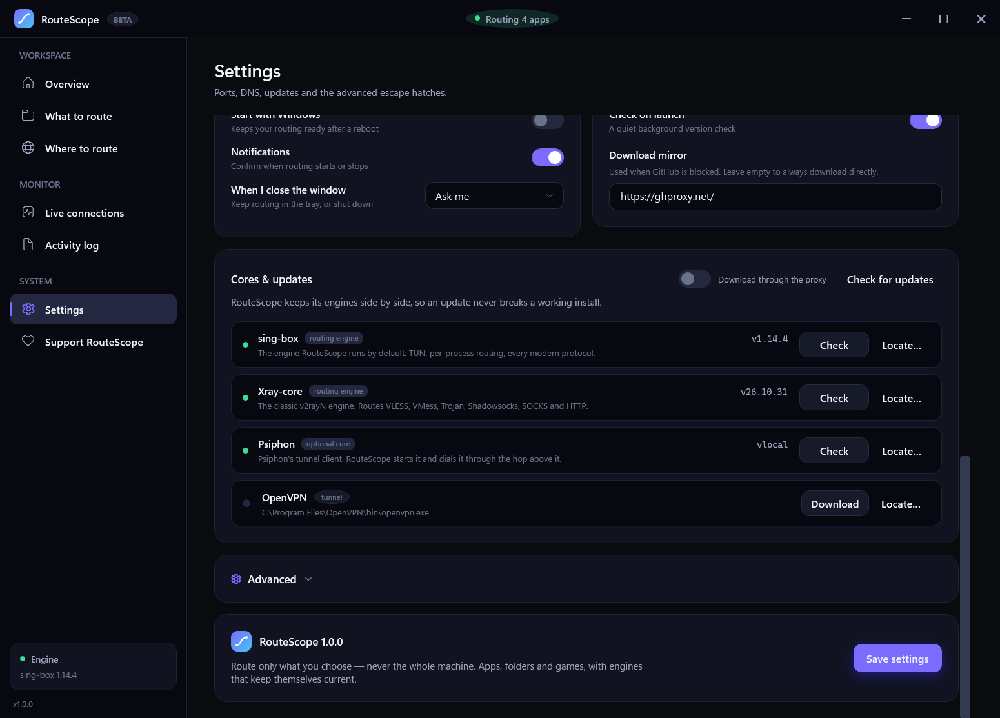

# RouteScope — a guided tour



Everything below matches what you see on screen. If a step looks different, you are probably
on an older build.

---

## 1. First run

RouteScope asks one question: **how should traffic be captured?**

| Answer | Pick it when |
| --- | --- |
| **Process mode** | You want to proxy a game or a launcher that has no proxy settings. Needs administrator. |
| **App proxy** | You would rather not run as administrator, and the app understands proxies (browsers, Discord, dev tools). Everything that connects to the local port uses the full route. |
| **Whole computer** | You genuinely want every app routed. |

Keep **Process mode** unless you have a reason not to. You can switch at any time.

> Why administrator? Process mode loads a kernel filter driver that reports outgoing
> connections per process. Without it there is no way to redirect an app that never asks
> for a proxy.

---

## 2. What to route



Add the thing you want proxied:

- **A folder** — matches every executable inside it, including subfolders. Best for game
  installs, because the launcher and the game itself are usually in the same place.
- **An application** — one `.exe`.
- **A process name** — for apps that spawn from a temporary path.

You can also **drag an `.exe` or a folder** anywhere onto this page.

Child processes are expanded automatically, so picking `Steam` covers the games it launches.

A green **proxied** badge appears next to a target once RouteScope has actually seen one of its
connections go through the tunnel. That is real evidence, not a guess.

---

## 3. Where to route



This is where traffic should go. Three ways to fill it:

### Use a proxy you already run

Press **Scan for local proxies**. RouteScope enumerates every listening TCP port on the machine
and speaks a real SOCKS5 or HTTP handshake to each one — it is not a fixed port list, so a
proxy on 2801 is found just as reliably as one on 10808. Ports that answer with something else
are ignored.

The quick-add row covers the common ones: v2rayN on 10808, Clash on 7890, Psiphon on 8080.

### Add a server

Paste a share link — `vless://`, `vmess://`, `trojan://`, `ss://`, `hysteria2://`, `tuic://`,
`socks://`, `http://` — and press **Add server**. Everything is editable afterwards: UUID,
password, cipher, flow, SNI, ALPN, fingerprint, Reality keys, transport settings, host, path,
gRPC service name. **Copy link** gives you the share link back, including parameters RouteScope
does not model.

### Import a tunnel

- **WireGuard** — press *Add WireGuard*, or drop a `.conf` on the list.
- **OpenVPN** — drop an `.ovpn`. If it needs a login you will be asked for it once.

Both are normalised at start so hand-written files work: `dev tunN` becomes `dev tun`, and
machine-wide options such as `setenv opt block-outside-dns` are removed (they would block DNS
on every other adapter). Each change is written to the Activity log.

### Subscriptions

Paste a subscription URL and press **Add subscription**. **Update** refreshes it later;
**Update via proxy** does the same through your current route, for hosts that are blocked.

Both node lists and whole-config subscriptions are understood. A subscription that hands out
complete Xray configs becomes a managed entry that RouteScope runs as-is.

---

## 4. Chaining



The **route** card at the top shows the path in order. Add a second hop and traffic is tunnelled
through both:

```
your apps → v2rayN (127.0.0.1:10808) → Frankfurt · vless → the internet
```

That means the engine reaches Frankfurt's server *through* v2rayN, then sends everything out
from Frankfurt. Useful when your own connection is filtered but a local client already works.

Hops can be reordered and removed individually. Two kinds of ping:

- **the latency figure** — a plain TCP reachability check
- **the stopwatch button** — a *real* tunnel to the internet through that hop, which is what
  actually matters

---

## 5. Start routing



Press **Start routing**. In process mode you will be asked for administrator once.

You get a live graph, session totals, and the count of open connections. The target chips on the
left show how many connections each app currently has.

To confirm it works: launch the app, then check **Live connections**.

---

## 6. Live connections and the log



Every connection RouteScope is handling right now, with the process, the destination, and the
rule that matched it. `proxy` means it went through your route; `direct` means it was allowed
straight out.

The same destination appearing many times is normal — apps open parallel connections.



The **Activity log** is the first place to look when something does not work. It records engine
output and every decision RouteScope made. *Open log folder* gives you the raw file to attach to
a bug report.

---

## 7. Settings worth knowing



- **Engines** — sing-box and Xray-core, updated side by side. A failed update never breaks a
  working install. **Locate…** registers a copy you already have.
- **Download through the proxy** — turn this on when GitHub is unreachable.
- **Download mirror** — used automatically when a direct download fails.
- **Psiphon** — download it here, pick an exit country, then chain it after a local proxy. On its
  own Psiphon often cannot reach its servers where they are blocked; that is what the chain is for.
- **OpenVPN** — point at `openvpn.exe`. The bundled edition already includes one.

---

## 8. Common problems

| Symptom | Cause | Fix |
| --- | --- | --- |
| "needs administrator" | Process mode | Approve the prompt, or switch to App proxy |
| Nothing is proxied, badge never appears | Wrong target | Check the exact path in *What to route*; use the running-app picker |
| "Nothing can pass through it" | The route itself is broken | Try the same server in another client; check the Activity log |
| Subscription adds nothing | Link is a whole-config subscription | It will appear as a managed entry instead of individual nodes |
| OpenVPN says the adapter is busy | A previous `openvpn.exe` still runs | Wait a few seconds, or end it in Task Manager |
| Live connections is empty with Xray | Xray has no Clash API | Use sing-box for live stats |

---

## Getting help

Open an issue with:

1. What you expected and what happened
2. The relevant part of the **Activity log**
3. Your capture mode and route (no need to include credentials)

The log almost always contains the answer already.
